# CatchUp ⚡
### 100% In-Browser AI Conversation Analyst & Executive Triage Console

[](https://pals-mu.vercel.app/)
[](test_regression/)
[](AGENTS.md)
[](https://huggingface.co/)
[](#team--credits)

> **CatchUp** turns chaotic, 200+ message chat dumps (Slack, WhatsApp, Teams, Discord) into an organized, prioritized executive dashboard in seconds — running **100% privately in your browser** using on-device WebGPU inference. Zero server APIs. Zero data leaks.

---

## 📑 Table of Contents

- [The Core Problem & Walkaway](#-the-core-problem--walkaway)
- [Processing Engines: Local vs Cloud vs Instant](#-processing-engines-local-vs-cloud-vs-instant)
- [Key Features](#-key-features)
- [System Architecture](#-system-architecture)
- [Why Hybrid AI? (Neural + Heuristic)](#-why-hybrid-ai-neural--heuristic)
- [Workspace & UI Structure](#-workspace--ui-structure)
- [Project Directory](#-project-directory)
- [Verification & Test Suite](#-verification--test-suite)
- [Getting Started & Local Usage](#-getting-started--local-usage)
- [Security & Privacy Blueprint](#-security--privacy-blueprint)
- [Team & Credits](#-team--credits)

---

## 🎯 The Core Problem & Walkaway

### The Problem
In modern remote work and hackathons, team members return from meetings, lunches, or offline periods to find **walls of unread chat messages**. Critical decisions, assigned action items, and urgent blocker questions are buried across multiple conversational threads. 

Traditional solutions require sending confidential company transcripts to third-party cloud LLM APIs (OpenAI, Anthropic), creating **severe data privacy, compliance, and IP leakage liabilities**.

### The Walkaway (Value Proposition)
CatchUp delivers a complete **Executive Triage Console** tailored to user privacy needs:
1. **Total Privacy Guarantee (Local Hero)**: The conversation transcript **never leaves the user's browser**. Model weights run 100% locally via WebGPU shaders.
2. **Flexible Cloud & Instant Fallbacks**: When data is not sensitive or hardware is constrained, users can execute via ultra-fast cloud LLM APIs (Gemini 1.5 Flash, Groq, OpenAI) or an instant 5ms deterministic rule engine.
3. **Elimination of the Infinite Scroll**: Unlike generic LLM chat interfaces that dump a 3,000px vertical text stream, CatchUp provides an **interactive multi-column Bento dashboard** and **instant category view-switcher**.
4. **Zero Hallucination with Source Grounding**: Every extracted deliverable, task, decision, and question is strictly validated against the source text character-by-character.

---

## ⚙️ Processing Engines: Local vs Cloud vs Instant

CatchUp empowers users to pick the ideal execution profile right from the top navigation bar:

```
┌─────────────────────────────────────────────────────────────────────────────┐
│  Processing Engine:                                                         │
│  [🛡️ Local Private (WebGPU)]*   [⚡ Cloud Turbo (API)]    [⏱️ Instant Rules] │
└─────────────────────────────────────────────────────────────────────────────┘
  * Hero Default (Runs 100% on-device inside your browser)
```

| Engine Mode | Execution Runtime | Privacy Level | Speed / Latency | Best Used For |
| :--- | :--- | :--- | :--- | :--- |
| 🛡️ **Local Private** *(Default)* | **WebGPU** / Llama 3.2 1B Instruct via WebLLM | **100% On-Device** (Zero data leaves browser) | Initial load ~1.5GB model cache; inference ~2-5s | **Sensitive conversations**, enterprise IP, proprietary code, GDPR/HIPAA compliance |
| ⚡ **Cloud Turbo** | **Direct Client API** (Gemini 1.5 Flash, Groq Llama 3.1, OpenAI GPT-4o-mini) | **Direct to Provider** (Zero intermediate servers, BYOK) | Lightning fast (<1.5s total turnaround) | Non-sensitive transcripts, large threads, low-spec devices without WebGPU |
| ⏱️ **Instant Rules** | **Pure JavaScript** Deterministic Heuristic Engine | **100% Offline** (Zero network, zero download) | **~5ms instant** | Immediate triage, mobile browsers, emergency fallback if WebGPU is unsupported |

> [!NOTE]
> **Hardware Auto-Detection**: CatchUp automatically checks WebGPU support (`navigator.gpu.requestAdapter()`) on page load. If WebGPU is not supported by your hardware or browser, an informative alert appears and CatchUp smoothly transitions you to Instant Rules or Cloud Turbo mode without breaking.
>
> **BYOK Security**: All cloud API keys are saved purely in your browser's private `localStorage` (`catchup_api_key_*`). Keys are never sent to our servers, never logged, and never included in Git commits. Cloud outputs still pass through CatchUp's strict quote validation and deduplication pipeline.

---

## ✨ Key Features

| Category | Capability | Description |
| :--- | :--- | :--- |
| ⚡ **Needs Attention** | **Personalized Triage** | Automatically extracts blockers, urgent requests, and @mentions directed to you (or your customized `targetUser` filter). Includes self-mention guards. |
| 📝 **Executive Summary** | **Synthesized Briefing** | Generates concise, high-signal summary bullet points highlighting project status, key milestones, and critical risks. |
| 📋 **Action Items** | **Interactive Checklist** | Extracts tasks with explicit or inferred owners (`@Alice`), source quotes, and clickable checkboxes with strike-through completion states. |
| 🎯 **Decisions Made** | **Consensus Register** | Distinguishes finalized agreements from tentative proposals, filtering out speculative hedges and "TBD" items. |
| ❓ **Open Questions** | **Temporal Resolution** | Tracks unresolved questions and automatically resolves questions that were answered within 2 subsequent messages using semantic and token overlap. |
| 🎛️ **View Switcher** | **No-Scroll Dashboard** | Toggle between **Overview** (2-column balanced executive dashboard) and focused single-category views (`Needs You`, `Tasks`, `Decisions`, `Questions`). |
| 📤 **Export & Report** | **One-Click Sharing** | Formats findings into an executive Markdown report with one-click clipboard copying (with fallback) and direct `.md` file download. |

---

## 🏗️ System Architecture

CatchUp operates on a **Dual-Stream Hybrid Architecture**, merging probabilistic neural generation with deterministic linguistic heuristics to achieve both contextual intelligence and deterministic reliability.

```mermaid
flowchart TD
    subgraph Client ["Client Browser (100% In-Memory Sandbox)"]
        Raw["Raw Conversation Transcript\n(Paste or .md/.txt File Drop)"]
        Parser["engine.js :: parseConversation()\n• Regex Line Matcher\n• Zero-padded msg_XX generation\n• Timestamp & Sender Normalization"]
        
        Raw --> Parser
        
        subgraph HybridEngine ["Dual-Stream Hybrid Analysis"]
            direction TB
            subgraph Stream1 ["Stream A: Local Neural Inference"]
                WebLLM["WebLLM / WebGPU\n(Llama-3.2-1B-Instruct-q4f16_1)\n• System Prompting with Strict Schema\n• Low-temperature (0.1) inference"]
                JsonSanitizer["JSON Parsing & Sanitization\n• CRLF & Code-Fence Stripping\n• Placeholder Rejector"]
                QuoteValidator["Quote & Evidence Validation\n• Exact Substring Verification\n• Source ID Linking\n• Hallucination Pruning"]
                WebLLM --> JsonSanitizer --> QuoteValidator
            end

            subgraph Stream2 ["Stream B: Deterministic Heuristics"]
                Heuristics["heuristics.js :: extractDeterministicFindings()\n• Target User Mention Matching\n• Negation & Vague Hedge Suppression\n• Question Resolution State Engine\n• Decision Keyword & Uncertainty Guards"]
            end
            
            Parser -->|Structured Messages| Stream1
            Parser -->|Structured Messages| Stream2
        end
        
        subgraph Fusion ["Fusion & Deduplication"]
            Dedupe["heuristics.js :: dedupe()\n• Pass 1: Source ID + Quote Signature Keying\n• Pass 2: Owner Divergence Preservation\n• Neural & Deterministic Synthesis"]
            QuoteValidator --> Dedupe
            Heuristics --> Dedupe
        end
        
        subgraph UI ["Executive View Layer (Safe DOM)"]
            AppController["app.js\n• View Switcher State Engine\n• textContent / createElement Only\n• Metric Summary Counts & Badges"]
            Dashboard["index.html + style.css\n• 2-Column Balanced Executive Layout\n• Focus Tabs (Overview, Tasks, Decisions)\n• Internal Scrollable Finding Rails"]
            Dedupe --> AppController --> Dashboard
        end
    end
```



---

## 🔬 Why Hybrid AI? (Neural + Heuristic)

Most conversational AI assistants rely purely on LLM generation, leading to three common failures:
1. **Quote Hallucinations**: Small models often fabricate or paraphrase quotes that were never actually spoken in the chat.
2. **Missed Direct Assignments**: Complex edge cases (e.g. `"@Bob, can you finish the report?"`) can get lost in prompt tokenization.
3. **Fragility on Low-Resource Devices**: If a mobile device or weak GPU encounters memory pressure, a pure-LLM app fails completely.

### The CatchUp Difference:
CatchUp pairs **Llama 3.2 1B (via WebGPU)** with **Stateless Deterministic Heuristics**:
- **Strict Evidence Validation**: Every neural finding is cross-checked against the raw message text. If the quote cannot be verified character-for-character, it is discarded.
- **Two-Pass Deduplication (`dedupe()`)**: Synthesizes LLM discoveries with deterministic pattern-matching. If both streams identify the same task, they collapse into a single verified item; if owners diverge, both perspectives are preserved.
- **Guaranteed Fallback**: Even if WebGPU initialization is slow or unsupported, the deterministic heuristics instantly surface urgent mentions, confirmed tasks, decisions, and open blockers.

---

## 🖥️ Workspace & UI Structure

CatchUp eliminates the vertical wall of text through an **Executive Triage Layout**:

```
┌─────────────────────────────────────────────────────────────────────────────┐
│  CatchUp — Conversation Analysis Dashboard                  [Local AI: Ready]│
├─────────────────────────────────────────────────────────────────────────────┤
│  METRICS BAR:                                                               │
│  [⚡ Needs You: 1]    [📋 Tasks: 3]    [🎯 Decisions: 1]   [❓ Questions: 2] │
├─────────────────────────────────────────────────────────────────────────────┤
│  VIEW TABS:  [✦ Overview]  [⚡ Needs You]  [📋 Tasks]  [🎯 Decisions] [❓ Questions]│
├──────────────────────────────────────┬──────────────────────────────────────┤
│  PRIMARY COLUMN (60% Desktop)        │  SECONDARY COLUMN (40% Desktop)      │
│  ──────────────────────────────────  │  ──────────────────────────────────  │
│  • Executive Summary                 │  • Needs Your Attention              │
│    Concise synthesized takeaways     │    Crimson-accented high priority    │
│    and project status.               │    alert cards with direct actions.  │
│                                      │                                      │
│  • Action Items & Deliverables       │  • Decisions Made                    │
│    Interactive checklist with        │    Emerald-accented confirmed        │
│    checkboxes, @owner pills, and     │    consensus items.                  │
│    citation references.              │                                      │
│    (Internally scrollable rail)      │  • Open Questions & Blockers         │
│                                      │    Amber-accented unresolved items.  │
└──────────────────────────────────────┴──────────────────────────────────────┘
```

---

## 📁 Project Directory

```
d:\PALS_\
├── index.html                   # Semantic markup, executive dashboard layout, accessible DOM
├── style.css                    # Design system tokens, multi-column bento grid, dark/light accents
├── app.js                       # UI controller, state management, safe DOM rendering, export handlers
├── engine.js                    # WebLLM wrapper, Llama-3.2 prompt lifecycle, quote evidence validator
├── heuristics.js                # Deterministic pattern extractor, negation filter, two-pass dedupe
├── vercel.json                  # Production headers (X-Frame-Options, X-Content-Type-Options, nosniff)
├── AGENTS.md                    # Project-wide architecture principles and rules
├── README.md                    # Comprehensive documentation and architecture specification
│
└── test_regression/             # Automated test harnesses (113 passing tests)
    ├── runner.js                # Core regression runner (23 unit & contract tests)
    ├── deep_stress.js           # Deep stress suite (62 stress tests across 7 categories)
    └── adversarial.js           # Adversarial suite (28 real-world edge-case tests)
```

---

## 🧪 Verification & Test Suite

CatchUp is backed by a rigorous, multi-round regression testing suite consisting of **116 automated tests** with **0 failures**:

```bash
# Run all regression and stress suites
node test_regression/runner.js
node test_regression/deep_stress.js
node test_regression/adversarial.js
```

### Breakdown of Test Suites:

1. **`runner.js` (26 Contract & Engine Tests)**:
   - Explicit assignee vs. sender recognition (`@Bob I will do it` → owner: Bob).
   - Non-assignment mention filtering.
   - Dynamic `targetUser` matching and null-fallback routing.
   - Negation filtering (`"I can't make it"` is never an action).
   - Vague hedge filtering (`"I will think about it"` / `"We will see"` excluded).
   - URL query parameter isolation (`?` in URLs does not trigger open questions).
   - Malformed message payload and null-sender resilience.
   - Heuristic instant engine execution via `analyzeConversation` with hardware detection checks.
   - Direct substantive answer resolution without positive-ack keywords.
   - Built-in sample conversation multi-engine benchmark (validating team deliverables, decisions, and open blockers).

2. **`deep_stress.js` (62 Stress Tests)**:
   - Category 1: `parseConversation` formats (standard, WhatsApp, timestamps, multiline).
   - Category 2: Needs You attention & self-mention exclusion.
   - Category 3: Open question detection and auto-resolution keyword engine.
   - Category 4: Action items & team imperatives (`@Team`, `Everyone must`).
   - Category 5: Decision consensus vs. tentative proposals (`maybe`, `undecided`).
   - Category 6: Deduplication logic across mixed LLM and heuristic outputs.
   - Category 7: High-throughput benchmark (100 messages parsed and extracted in <100ms).

3. **`adversarial.js` (28 Adversarial Tests)**:
   - Short-token time answer resolution (e.g. `"Can we meet at 1 PM?"` answered by `"1 PM works for me"`).
   - Pure standalone acknowledgments (`"confirmed"`, `"works for me"`).
   - TBD and "agreed to disagree" suppression.
   - Large conversation scaling (>200 messages sequential ID ordering).

---

## 🚀 Getting Started & Local Usage

### Prerequisites
- Any modern web browser supporting **WebGPU** (Chrome 113+, Edge 113+, Firefox Nightly, Safari 18+).
- Optional: [Node.js](https://nodejs.org/) (v18+) to run the regression test suite.

### Running Locally
Because CatchUp is built with pure ES Modules, it can be served using any local static file server:

```bash
# Clone the repository
git clone https://github.com/guptavernit2-afk/PALS_.git
cd PALS_

# Serve using Python
python -m http.server 8000

# Or serve using Node.js npx
npx serve .
```

Open your browser at `http://localhost:8000`.

### Using the Application
1. **Choose Engine Profile**: Choose **🛡️ Local Private** (default WebGPU) for confidential data, **⚡ Cloud Turbo** (Gemini/Groq/OpenAI) for fast BYOK inference, or **⏱️ Instant Rules** for instant 5ms extraction.
2. **Target User (Optional)**: Enter your name (e.g. `Alice` or `@Alice`) in the target user input to personalize high-priority alerts under **Needs You**.
3. **Load Conversation**: Click **"Load sample"** to test with our built-in hackathon planning transcript, paste your own text, or drop a `.md` / `.txt` file into the dropzone.
4. **Analyze**: Click **"Analyze Conversation"**.
5. **Triage & Export**: Use the view tabs to review tasks and decisions, toggle completed checkboxes, and click **"Copy Markdown"** or **"Download .md"** to export your meeting minutes.

---

## 🔒 Security & Privacy Blueprint

- **Zero Remote Telemetry (Local Mode)**: CatchUp transmits 0 bytes of conversation data over the network in Local Private mode. All inference occurs in WebGPU shaders on your machine.
- **Client-Side Secret Storage (Cloud Mode)**: When using Cloud Turbo, user API keys are stored exclusively in the browser's origin-scoped `localStorage`. No proxy server, logging, or token sniffing is ever performed.
- **XSS Immunity (Safe DOM Only)**: Model and user strings are strictly inserted using `node.textContent` and `document.createElement`. No `innerHTML` or `eval` execution of external or AI-generated strings.
- **Hardened Deployment**: Configured via `vercel.json` with strict HTTP security headers:
  - `X-Content-Type-Options: nosniff`
  - `X-Frame-Options: DENY`
  - `Referrer-Policy: strict-origin-when-cross-origin`

---

## 👥 Team & Credits

Built with pride by team **PALS_** for the **PROTOCOL X** Hackathon:

* **Engine Architecture & AI**: Deterministic heuristic engine, WebLLM integration, quote validator, cloud BYOK pipeline.
* **Frontend & UI/UX**: Executive triage dashboard, engine mode switcher, segmented view switcher, responsive bento grid.
* **Testing & Hardening**: 114-test regression harness, adversarial stress testing.

*CatchUp — Catch up on what matters, 100% on your device.*
