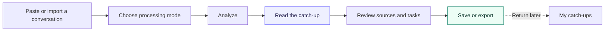
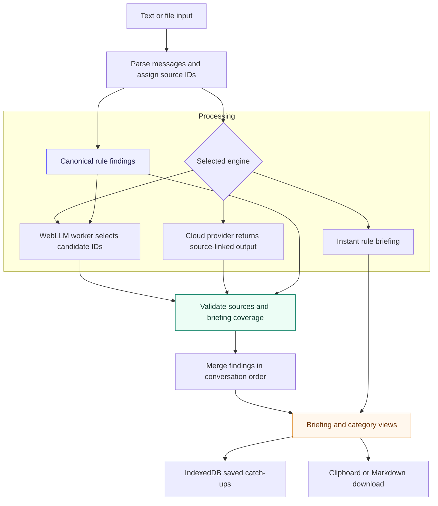
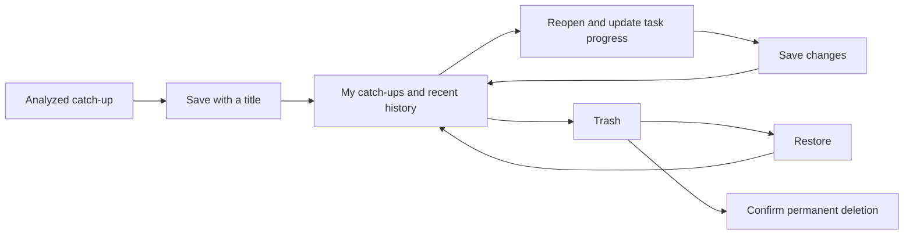

<div align="center">

# CatchUp

### Catch up on what matters.

Turn long conversations into a clear briefing of decisions, tasks and unanswered questions.<br>
**Understand the conversation first. Follow through next.**

[](https://catchup-workspace.vercel.app/)
[](https://github.com/guptavernit2-afk/CatchUp/actions/workflows/tests.yml)
[](#verification)
[](#technology)
[](#processing-modes)

[**Try the app**](https://catchup-workspace.vercel.app/) · [**Quick start**](#run-locally) · [**Architecture**](#architecture) · [**Documentation**](docs/README.md) · [**Report an issue**](https://github.com/guptavernit2-afk/CatchUp/issues)

A personal project built and maintained by [Vernit](https://github.com/guptavernit2-afk).

</div>

---

## Why CatchUp?

A conversation can contain a decision, a changed plan, an assigned task and an unanswered question—all mixed with ordinary chatter. Returning to that thread should not mean reading every message before you can act.

CatchUp brings the important parts into one workspace, with source quotes so you can check the original context. Choose how your conversation is processed, save a titled catch-up, and return when you need it.

| Catch up | Understand | Follow through |
| :---: | :---: | :---: |
| Read a concise, source-based briefing | See decisions, blockers and what needs you | Track tasks, save progress and export a report |

<details>
<summary><strong>Explore this README</strong></summary>

- [Product workflow](#product-workflow)
- [A conversation, caught up](#a-conversation-caught-up)
- [Workspace and features](#workspace-and-features)
- [Processing modes](#processing-modes)
- [Architecture](#architecture)
- [Reliability and evidence](#reliability-and-evidence)
- [Technology](#technology)
- [Run locally](#run-locally)
- [Saved reports and privacy](#saved-reports-and-privacy)
- [Verification](#verification)
- [Repository structure](#repository-structure)
- [Scope and limitations](#scope-and-limitations)
- [Documentation and contributing](#documentation-and-contributing)

</details>

## Product workflow



1. **Bring a conversation.** Paste text, drop a `.txt` or `.md` file, or use the built-in sample.
2. **Pick your engine.** Choose Local Private, Cloud Turbo or Instant Rules. Optionally enter your name for personalized attention.
3. **Get the catch-up.** Start with the overview, then switch to Needs You, Tasks, Decisions or Questions.
4. **Follow the evidence.** Check source quotes and confirmations; mark completed tasks as you work.
5. **Keep what matters.** Save with a title, choose **Save changes** after editing progress, or copy/download Markdown.

## A conversation, caught up

**Input**

```text
Alice: Bob, can you review the login tests before Friday?
Bob: I will review the login tests before Friday.
Carol: We decided to use PostgreSQL for storage.
Dave: API access is still pending.
```

**What CatchUp extracts**

| Finding | Result | Evidence |
| --- | --- | --- |
| Task | **Bob · Confirmed** — review the login tests before Friday | Alice's request, linked to Bob's commitment |
| Decision | Use PostgreSQL for storage | Carol's explicit choice |
| Open blocker | API access is still pending | Dave's unresolved status |

This example was checked against the production Instant Rules pipeline. Finding cards retain the original quote and message references; the descriptions above are a readable explanation of those findings.

## Workspace and features

| Area | What it helps you do |
| --- | --- |
| **Executive briefing** | Catch up through selected source messages or a clearly labelled rule briefing when model selections are incomplete. |
| **Needs You** | Find relevant mentions and requests using an optional target name. |
| **Tasks** | See owners, requested/confirmed status, acceptance evidence and completion checkboxes. |
| **Decisions** | Review explicit choices and contextual agreements with their supporting messages. |
| **Questions and blockers** | Identify unresolved questions and pending items, including blockers without a question mark. |
| **My catch-ups** | Save titled reports; search, rename, reopen, move to Trash, restore or permanently delete them. |
| **Recent history** | Reopen recent saved catch-ups directly from the sidebar. |
| **Collapsible sidebar** | Give the workspace more room when navigation is not needed. |
| **Markdown export** | Copy or download findings, task progress, sources and fallback notices. |

The overview keeps the briefing and finding categories together. Focus tabs narrow the view when you want to inspect one category, while saved catch-ups retain the transcript, findings and task progress for later.

## Processing modes

| | Local Private | Instant Rules | Cloud Turbo |
| --- | --- | --- | --- |
| **Execution** | WebLLM in a dedicated browser worker | Deterministic JavaScript | Direct browser request to your provider |
| **Briefing** | Llama 3.2 1B selects source-message IDs | Built from extracted findings | Source-linked model selections, then validation |
| **Transcript destination** | Processed on your device | Processed on your device | Sent to the selected provider |
| **Requirements** | Working WebGPU browser/GPU; model download on first use | No model or API key | Your API key, model access, network and quota |
| **Use it when** | You want on-device model inference | You want to start immediately without model setup | You want to use your chosen cloud provider |

Cloud Turbo supports **Gemini, Groq, OpenAI and compatible custom endpoints**. Provider settings and keys are kept separate. Model defaults are defined in `engine.js`; the UI shares the Gemini default.

> [!NOTE]
> Local AI selects briefing messages; canonical task, decision, question and attention findings follow shared rule policies. Exact source validation and coverage checks improve consistency, but cannot guarantee that every conversation is interpreted correctly.

<details>
<summary><strong>Local model and recovery details</strong></summary>

| Setting | Current implementation |
| --- | --- |
| Runtime | WebLLM **0.2.87** |
| Model | `Llama-3.2-1B-Instruct-q4f16_1-MLC` |
| Model output | Up to four message IDs in constrained JSON |
| Generation | Temperature `0.1`; maximum `128` tokens |
| Input limit | 200 messages or 12,000 serialized characters |
| Deadlines | Three minutes for loading; one minute for inference |
| Worker lifecycle | Ready-worker reuse, cancellation, bounded cleanup and fresh-worker recovery |

The host identifies finding-backed candidates before local inference and copies selected source text into the briefing. If no findings provide candidates, the original conversation is supplied. Invalid, empty or incomplete selections use a labelled Instant Rules briefing. Candidate filtering depends on rule detection and can miss facts the detector does not recognize.

</details>

## Architecture

CatchUp is a static application built with native JavaScript modules. Parsing, analysis orchestration, validation, persistence and rendering are separate modules; no application backend or frontend build step is required.



| Layer | Modules | Responsibility |
| --- | --- | --- |
| **Workspace** | `app.js`, `sidebar.js`, `library-ui.js` | Analysis flow, safe text rendering, navigation and library controls |
| **Analysis** | `engine.js` | Transcript parsing, provider requests, mode selection and result orchestration |
| **Finding policy** | `heuristics.js` | Ownership, task states, questions, decisions and deduplication |
| **Evidence** | `evidence.js` | Source-ID and exact-quote validation, canonical finding checks |
| **Local runtime** | `local-runtime.js`, `local-worker.js` | WebLLM loading, worker reuse, deadlines and cancellation |
| **Persistence and export** | `saved-catchups.js`, `report.js` | Browser-local reports, revision checks and shared Markdown formatting |

[Explore the architecture guide →](docs/ARCHITECTURE.md)

## Reliability and evidence

| Situation | CatchUp's policy |
| --- | --- |
| A task is assigned but not accepted | Keep it **requested**, with the named owner where explicit. |
| The assignee makes a matching commitment | Mark it **confirmed** and retain acceptance evidence. |
| Someone offers help conditionally | Do not treat the condition as unconditional acceptance. |
| A decision is followed by a clear agreement | Retain the choice and linked agreement where context is unambiguous. |
| A model quote omits a condition or negation | Expand a valid summary selection to its complete source message. |
| A briefing fails detected-finding coverage | Use a clearly labelled Instant Rules briefing. |
| A local run is cancelled or fails | Preserve the input flow, prevent stale results and allow runtime recovery. |
| An older tab tries to overwrite a newer saved report | Reject the stale update instead of replacing newer work. |

These checks establish source provenance and consistent policy. Implicit meaning and ambiguous conversations still require judgment.

## Technology

| Part | Technology |
| --- | --- |
| Interface | HTML, CSS, native JavaScript modules and browser DOM APIs |
| On-device inference | WebGPU, WebLLM and Llama 3.2 1B Instruct |
| Instant analysis | JavaScript extraction and context rules |
| Cloud inference | Direct provider APIs using your own key |
| Saved reports | IndexedDB; separate `localStorage` preferences and provider keys |
| Development checks | Node's test runner, `fake-indexeddb`, opt-in `playwright-core` live audits |
| CI and hosting | GitHub Actions and Vercel |

The browser app has no npm runtime dependencies. npm packages support development and testing.

## Run locally

```sh
git clone https://github.com/guptavernit2-afk/CatchUp.git
cd CatchUp
python -m http.server 8000 --bind 127.0.0.1
```

Open **http://127.0.0.1:8000**, choose **Instant Rules** and load the sample to start without a key or model download.

| Requirement | When you need it |
| --- | --- |
| A local HTTP server | Native modules should be served over HTTP rather than opened through `file://`. Python 3 is used above; another suitable static server also works. |
| WebGPU and a compatible GPU | Local Private mode; availability depends on the browser and hardware. Use HTTPS or a loopback origin. |
| A provider key | Cloud Turbo only. Configure it in the app's processing settings. |
| Node.js 18+ | Development and regression tools only. |

Supported transcripts include `Name: message`, timestamped messages and common iOS/Android WhatsApp text exports. Other formats may need reformatting. The development server should stay on loopback; do not publicly serve a checkout containing credentials or Git metadata.

## Saved reports and privacy



- **Reports stay browser-local.** IndexedDB stores transcripts, findings, titles and task progress. Save progress explicitly with **Save changes**.
- **Keys are stored separately.** Provider keys and preferences live in origin-scoped `localStorage` and are excluded from saved reports.
- **Export is a separate copy.** Download Markdown for a backup outside browser storage. Clearing site data can remove the browser library.
- **Local processing still has setup traffic.** Runtime/model files are downloaded and the page loads external fonts. Cloud mode sends transcripts to the provider you select.

> [!IMPORTANT]
> Browser storage is not an encrypted vault or an account backup. Other people using the same browser profile may access it. The current address is [catchup-workspace.vercel.app](https://catchup-workspace.vercel.app/); the [previous address](https://pals-mu.vercel.app/) remains available for existing saved reports. Storage and API settings do not automatically move between addresses.

[Read the data handling and privacy guide →](docs/PRIVACY.md)

## Verification

### Offline regression coverage

**1,719 automated checks** cover parsing, finding policy, source evidence, task/decision context, worker recovery, saved-report persistence, exports and adversarial inputs.

```sh
npm ci
npm test
```

GitHub Actions runs the offline suite on **Node 18, 22 and 24**. It does not need API keys, download a model or launch a GPU browser.

### Live engine checks

The live audit on **8 November 2026** exercised the production pipeline with real model responses:

| Engine | Fixtures | Final-output checks | What the result means |
| --- | --- | --- | --- |
| Exact local WebLLM | 80 short chats + 5 longer chats | **85/85 passed** | Two briefings used a labelled rule fallback; source filters removed filler selections. |
| Live Gemini | 5 short chats + 5 longer chats | **10/10 passed** | Rules corrected one requested-task omission in the raw model response. |

These are synthetic fixture checks, not a general accuracy percentage. The five long fixtures vary fact placement among chatter; they are not five independent real-world topics. Raw model mistakes and corrected final output are documented separately.

<details>
<summary><strong>Quality tools and opt-in live audits</strong></summary>

```sh
# Offline quality checks and timing measurements
npm run test:quality
npm run audit:quality
npm run benchmark:quality

# Preflight only: no authenticated provider call or local inference
npm run audit:gemini
npm run audit:local

# Opt-in real model runs
npm run audit:gemini -- --run --limit 5
npm run audit:local -- --run --limit 80
npm run audit:local -- --run --long --limit 5
```

Live Gemini requires `GEMINI_API_KEY` in the process environment or ignored `.env.local` and consumes provider quota. The exact local runner needs installed Chrome and hardware WebGPU; it uses a headless browser and an isolated test profile. Reports and model cache are ignored under `.live-tests/`.

The quality suite expands synthetic chats across input formats and participant names. Mocked provider responses verify contracts, not real model intelligence. See the audits for the full scope and practical limits.

</details>

[Testing guide](docs/TESTING.md) · [Internal quality audit](docs/quality/ENGINE_QUALITY.md) · [Live engine audit](docs/quality/LIVE_ENGINE_AUDIT.md)

## Repository structure

```text
CatchUp/
├── .github/
│   ├── workflows/tests.yml          # Offline CI across Node versions
│   └── pull_request_template.md     # Change and verification guidance
├── docs/
│   ├── README.md                    # Documentation index
│   ├── ARCHITECTURE.md              # Analysis, runtime and persistence design
│   ├── PRIVACY.md                   # Data destinations, storage and deletion
│   ├── TESTING.md                   # Reproduction and live-audit commands
│   └── quality/                     # Internal and real-model audit reports
├── test_regression/                 # Test suites, synthetic fixtures and audit runners
├── index.html                       # Workspace markup
├── style.css                        # Layout, component styles and responsive behavior
├── app.js                           # Analysis and result UI controller
├── sidebar.js                       # Sidebar collapse state
├── library-ui.js                    # Saved catch-up library controls
├── engine.js                        # Parsing, providers and result orchestration
├── heuristics.js                    # Canonical findings and context rules
├── evidence.js                      # Source validation
├── local-runtime.js                 # Worker lifecycle and recovery
├── local-worker.js                  # Pinned WebLLM worker
├── saved-catchups.js                 # IndexedDB persistence and revision checks
├── report.js                        # Markdown formatting
├── vercel.json                      # Deployment response headers
├── CONTRIBUTING.md                  # Development and issue-reporting guide
└── README.md
```

## Scope and limitations

CatchUp is a working personal browser workspace. Accounts, cloud sync, shared workspaces and automatic chat-service integrations are outside the current version.

Extraction is conservative and primarily tested in English. Implicit assignments, sarcasm, ambiguous pronouns, complex revisions and other languages can be missed. Briefings are bounded; review the category lists and source messages for detail. Existing saved reports keep their original findings until the transcript is reanalyzed.

## Documentation and contributing

| Resource | Start here for |
| --- | --- |
| [Architecture](docs/ARCHITECTURE.md) | Understanding the analysis pipeline and module boundaries |
| [Privacy](docs/PRIVACY.md) | Knowing where transcripts, reports and credentials go |
| [Testing](docs/TESTING.md) | Reproducing offline checks and real-model audits |
| [Contributing](CONTRIBUTING.md) | Reporting a bug or proposing a focused improvement |
| [Issues](https://github.com/guptavernit2-afk/CatchUp/issues) | Sharing a reproducible problem with an anonymized example |

---

<div align="center">

**CatchUp — less catching up, more moving forward.**

[Open the workspace](https://catchup-workspace.vercel.app/) · [View the source](https://github.com/guptavernit2-afk/CatchUp)

</div>
