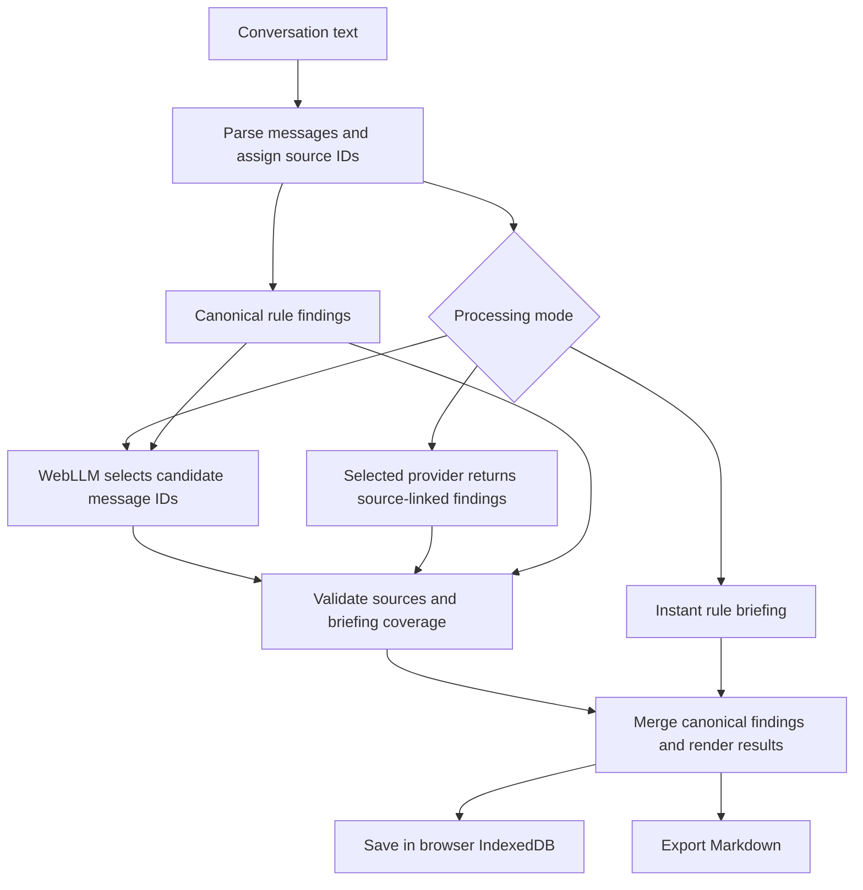

# Architecture

CatchUp is a static browser application with native JavaScript modules. There is no application server, account database or frontend build pipeline. Dependencies in `package.json` are development-only tools.

## Analysis flow

`engine.js` parses transcripts, selects the processing path and combines validated findings. `heuristics.js` implements finding policy. `evidence.js` checks source IDs and case-sensitive quote substrings; summaries retain the complete source message to avoid dropping a condition or negation.

## Finding policy

- **Requested tasks:** a named assignment or team imperative before acceptance.
- **Confirmed tasks:** a first-person commitment or matching acceptance from the assignee. Conditional offers and unrelated acknowledgements do not confirm a request.
- **Completion and withdrawal:** matching later messages update or remove the corresponding work where the rule policy recognizes the relation.
- **Decisions:** explicit choices and unambiguous adjacent agreement retain source context. Ambiguous bare agreement is omitted.
- **Questions and attention:** rule checks track unanswered questions, pending blockers and relevant mentions. The same canonical policy applies across all modes.

Cloud output cannot freely rewrite canonical task or decision status. Source validation establishes provenance, not semantic certainty. Rule-based corroboration trades some recall for consistency.

## Local AI

`local-runtime.js` manages a dedicated module worker; `local-worker.js` loads pinned WebLLM 0.2.87 and `Llama-3.2-1B-Instruct-q4f16_1-MLC`.

The host identifies source-message candidates from findings and confirmations. The model selects up to four IDs using a constrained JSON schema, temperature 0.1 and a 128-token generation limit. If no findings supply candidates, the model receives the original conversation. Host code copies source text rather than displaying generated paraphrases.

Loading and inference have separate deadlines: three minutes and one minute. A ready worker is reused. Cancellation interrupts the worker, allows bounded GPU cleanup and prevents late callbacks from overwriting a newer analysis. Worker failures can be retried with a fresh runtime.

Invalid, empty or incomplete briefing selections use a labelled Instant Rules briefing. Candidate filtering depends on the rule detector; facts excluded by that detector cannot be recovered by model selection.

## Cloud requests

Named providers use their configured endpoints and separate saved keys. Custom endpoints require HTTPS, except loopback HTTP, and cannot contain embedded URL credentials. Requests reject redirects and time out after 60 seconds. Provider errors are presented without raw response bodies or credentials.

Provider/model defaults live in `engine.js`; the UI shares the Gemini default. Model availability, provider browser access and quotas can change independently of the app.

## UI, persistence and exports

`app.js` controls analysis and renders source text through safe DOM APIs. `sidebar.js` handles collapse state. `library-ui.js` connects library controls to `saved-catchups.js`.

Saved reports and metadata are stored atomically in IndexedDB. The saved schema excludes API credentials and settings. Revision checks reject stale-tab updates and prevent deleted reports from being resurrected by an older tab. Task edits require an explicit save.

`report.js` provides a shared Markdown formatter for clipboard and download, including completion state, sources and fallback notices. `vercel.json` configures response security headers for the hosted static app.
